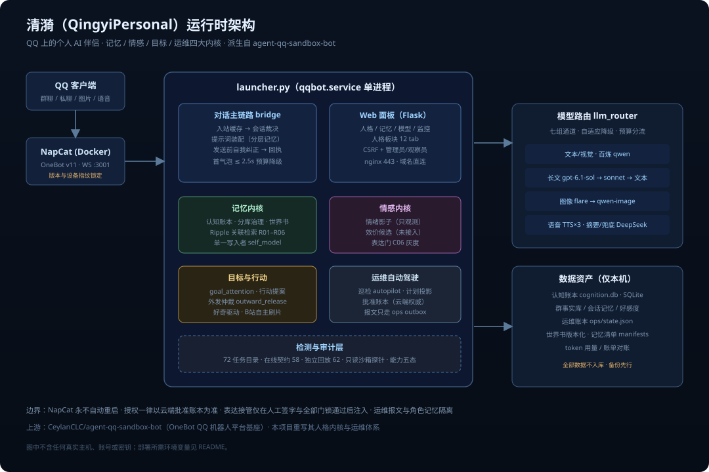

# QingyiPersonal

> 通用 QQ AI 伴侣平台：把 OneBot v11（NapCat）接入的 QQ 机器人，
> 养成一个**人格上连续的个体**——有记忆、有情绪动力学、有目标与做事方法。
>
> 本仓库是**白板**：只有平台与内核机制，**不内置任何具体人格**。
> 角色卡（性格、形象、称呼、关系）是部署方的数据，放 `DATA_DIR/personas/`，
> 平台的记忆/情感/目标系统对任何人格一视同仁。



---

## 为什么不是"又一个聊天机器人"

多数群聊 AI 是无状态的问答机：提示词决定语气，上下文决定内容，仅此而已。
QingyiPersonal 的差异在于**连续性是架构性的**：

| 内核 | 做什么 | 关键设计 |
|---|---|---|
| **记忆** | 事件账本、自传体记忆、逐命题来源标注、矛盾裁决、失效传播 | **单一写入者**：认知表只由一个模块写，其余全部只读（回归锁强制） |
| **检索** | Ripple 关联检索：命中对象 → 打分 → 关联边 → 涟漪路径 → 冲突消解 | 倒排索引毫秒级；权限先行；无关不兜底，宁缺勿滥 |
| **情感** | 情绪动力学持续观察对话流；效价候选独立记账 | 默认影子模式——情感是观测出来的，不是演出来的 |
| **表达** | 表达门：人工签字 + 全部门锁通过后，才允许注入有界语气 | 可撤回；未过门时行为与纯提示词版完全一致 |
| **目标** | 注意力调度、行动提案、外发仲裁、好奇驱动的自主行为 | 机会 ≠ 命令：没有够格的话题就闭嘴 |
| **运维** | 自动驾驶巡检：检查 → 达标自动推进 → 推不动如实汇报 | 批准账本独立存储；红线不可绕过 |

**证据分层**贯穿一切：亲历 / 听说 / 查到 / 推测 / 想象 永远不混写成"事实"；
发出请求 ≠ 对方收到；工具失败绝不记成完成。宁可说"不知道"，不伪造。

## 出身

本项目**脱胎于 [CeylanCLC/agent-qq-sandbox-bot](https://github.com/CeylanCLC/agent-qq-sandbox-bot)**
（一个可配置的 QQ 群 AI 机器人控制平台）。在其基座之上重写/新增了几乎全部核心：
人格内核（认知账本/证据分层/单一写入者）、Ripple 记忆检索、情感影子与表达门、
运维自动驾驶与批准账本、能力审计体系（任务目录/在线契约/独立回放/只读沙箱探针）、
记忆治理与世界书版本化、好感度机制、账单对账、桌宠端（`desktop/`）。

| 关系 | 仓库 |
|---|---|
| 上游基座 | [CeylanCLC/agent-qq-sandbox-bot](https://github.com/CeylanCLC/agent-qq-sandbox-bot) |
| 本项目 | [Theflowyears/QingyiPersonal](https://github.com/Theflowyears/QingyiPersonal) |

上游未声明许可证，其原始代码权利仍归 CeylanCLC；本仓库 [LICENSE](LICENSE)
仅覆盖 QingyiPersonal 的原创与重写部分。

## 架构

```
QQ 客户端
  ↓ QQ 协议
NapCat（Docker，OneBot v11 反向 WS :3001）
  ↓ ws://127.0.0.1:3001
launcher.py（单进程双角色）
  ├─ bot：对话主链路 + 记忆/情感/目标/运维内核
  └─ web：Flask 管理面板（:5000，nginx/域名对外）
```

```
bot/
  qq_openclaw_bridge.py   对话主链路（入站→裁决→装配→模型→自我纠正→投递→记忆）
  self_model.py           认知账本唯一写入者（事件/信念/承诺/目标/自观）
  memory_runtime.py       记忆编排：权限、注入预算、时间窗、真正注入请求
  ripple_*.py             关联检索 R01–R06（命中/打分/关联边/涟漪/冲突/证据）
  emotion_* / expression_gate   情感三件套（影子默认不接管）
  action_proposal / goal_attention / outward_release   目标与行动
  ops_autopilot / ops_channel / ops_remote / ops_dispatch   运维自动驾驶
  qingyi_roadmap / qingyi_preflight / phase_audit /
  contract_sandbox / capability_audit   检测与审计
  whale_persona.py        人格引擎（加载器：优先 DATA_DIR/personas/，回落中性演示）
  affection.py            好感度（角色自述为权威，算法仅兜底）
  llm_router.py           多模型通道路由 + 自适应降级 + 首气泡预算
  image_gen / tts / draw_flow / bili / qwen_agent   图像、语音、绘图流程、视频站、智能体
website/                  管理面板（Flask + 原生前端）
desktop/                  桌宠端（代码入库，精灵图资产不入库）
tests/                    199 个隔离测试模块（unittest）
docs/                     架构与路线文档
```

### 模型路由

通道全部环境变量化（见 `.env.example`），平台不绑定任何服务商：

| 用途 | 说明 |
|---|---|
| 文本/视觉 | OpenAI 兼容接口，任意供应商 |
| 长文/深度 | 独立通道，失败自动降级到备胎再到文本模型 |
| 摘要/压缩 | 独立低成本通道（后台任务，不占对话延迟） |
| 图像 | 异步任务 + 轮询 + 迟到结果回收（多图商降级链） |
| 语音/唱歌 | HTTP 与 WebSocket 两类通道，按次计费 |

延迟红线：**首气泡 ≤ 2.5 秒**。慢查询先"接住"再后台补发；补发失败也要出声。

## 人格包约定

平台与人格的唯一接缝是 `DATA_DIR/personas/`：

```
personas/active.py 或 personas/whale_persona.py
  可导出：PERSONA_CORE / VOICE_LOCK / CATCHPHRASES / CHAT_RULES /
          APPEARANCE / WHISPER_NOTE / PERSONA_META / build_persona_block()
  缺哪个用平台中性默认补哪个；加载失败回落中性演示人格并日志出声。
personas/persona_dict.txt   社群自定义分词（可选）
```

仓库内置的演示人格是**无性格倾向的通用助手**——名字、身世、口癖、关系
全部属于部署方，不属于平台。

## 路线图

| 阶段 | 内容 | 状态 |
|---|---|---|
| 0 | 证据分层、单一写入者、认知账本 | ✅ 落地，回归锁 |
| 1 | 自传体记忆、逐命题来源、矛盾裁决、失效传播 | ✅ 落地，回归锁 |
| 2 | 情感影子 + 表达门灰度（签字+门锁才注入） | ✅ 灰度运行 |
| 3a | Ripple 关联检索全链接线 | ✅ 落地 |
| 3b | 完整表达接管 | ⏸ 待真实数据与另行授权 |
| — | 运维自动驾驶（巡检/批准账本/指令通道） | ✅ 运行 |
| — | 能力审计（任务目录/在线契约/独立回放/沙箱探针） | ✅ 全绿 |

验收口径：`verify_phase.py`。**未落到代码或未通过审计的一律标注为拟议**；
部署不冒充长期验收（capability `released` 默认 false）。

## 快速开始

> 面向开发者/自托管。需要：Python 3.10+、可选 Docker（承载 NapCat/QQ）、若干模型 API。

**一条命令 + 一个配置面板**（详见 [QUICKSTART.md](QUICKSTART.md)）：

```bash
git clone https://github.com/Theflowyears/QingyiPersonal.git
cd QingyiPersonal
python setup.py --napcat --start
```

`setup.py` 建 venv、装依赖、生成 `config.env`（随机面板密钥 + 管理员凭据）、
可选创建固定 MAC 的 NapCat 容器、后台拉起服务。随后打开面板登录，进入 **`/setup` 快速配置向导**：
**填模型 API（带连通测试）→ 扫码登录 QQ → 看后台状态**，三步完成初始化。

```bash
# 手动方式：cp .env.example config.env 并填写，然后
python launcher.py            # 或配置 systemd（WorkingDirectory=/path/to/repo）
# 测试（无需任何真实凭据，全部隔离）
python tests/run_all.py
```

参数优先级：`data/control-v4/settings.json`（面板热改）> `config.env` > 代码默认。
向导在已完成初始化的部署里完全惰性，不影响正常运行。

## 红线（欢迎审查，不接受绕过）

1. 永不自动重启 NapCat 容器（QQ 登录态与设备指纹的稳定性高于一切）
2. 不删不覆盖用户数据；改数据先备份
3. 授权账本独立于代码——任何"接管/推进"需要部署方明确批准
4. 运维报文与角色记忆严格隔离：角色不该知道自己是怎么被部署的
5. 真实优先于好看：测不出来就写测不出来；负面结果如实报告
6. 具体人格内容不进平台代码、不进公开仓库

## 许可与声明

- 本项目原创部分：[MIT License](LICENSE)；上游基座代码版权归 CeylanCLC。
- 演示数据中的名字、事件、关系均为**虚构样例**；真实部署的人格与数据
  属于部署方，不在本仓库。
- 本软件按"现状"提供，不含任何明示或暗示的保证。机器人输出的每句话
  都是生成内容，不构成事实性主张或建议。

---

*连续性不是修辞，是架构。*
