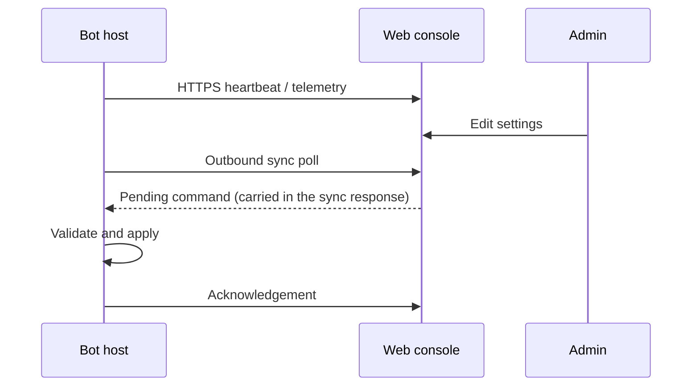

# 架构与数据流

## 运行平面

NapCat 通过 OneBot 11 WebSocket 把事件交给 Bridge。Bridge 在入口完成去重、发送者忽略和群黑名单判断，再决定写入上下文、调用视觉模型或 OpenClaw、以及回复 QQ。

群长期记忆只保存压缩摘要；短期缓存和巡群状态分别落盘。黑名单过滤在入口、装饰器、状态读写和遥测四处重复执行，避免单点遗漏。

## 控制平面

网站不主动访问机器人主机，适合两台不同云服务器。基础心跳与详细遥测独立，详细监控失败不会中断聊天。

## 命令的鉴权与完整性（实测口径）

控制面**没有**对请求体做 HMAC/RSA 签名。实际依赖三层：

1. 传输鉴权：一把共享随机令牌 `CEYLAN_BOT_TOKEN`，服务端用 `hmac.compare_digest` 做常量时间比较（只当比较器，不参与签名计算），要求长度 ≥ 32。
2. 命令契约：`ceylan_control_core.validate()` 只有 `settings` / `memory_set` / `cache_clear` / `cache_edit` 四个动词，数值型参数按 `RANGES`/`FLOATS`/`BOOLS` 严格校验类型与区间。网站入队前校验一次，机器人生效前再校验一次；不存在可执行 shell、任意路径或 Python 的命令面。
3. 乐观并发与防重放：`revision = sha256(sort_keys=True, separators=(',',':'))` 的三层比较（网站、apply、process）；命令 id 为 32 位十六进制并记入台账去重；过期时间要求落在 `(now, now+660]` 区间，过期时间过远的命令同样拒绝。

唯一真正的密码学绑定在密钥通道：机器人本地生成 RSA-4096，其 SPKI 公钥随 keys sync 上传，浏览器用 RSA-OAEP(SHA-256) 加密新 Key，OAEP label 固定为 `id:action:target:revision`，密文长度必须恰好 512 字节。因此一段密文与某一条命令一一绑定，既不能被挪用到别的命令，伪造的命令也带不出合法密文。明文密钥从不上行。

## 同机部署的文件桥

当机器人与网站在同一台主机（本项目现状）时，HTTP 往返被整体绕过：网站直接读 `data/control-v4/state.json`，并把命令 JSON 写进 `data/control-v4/inbox/`，由机器人的事件循环消费。`launcher.py` 负责把两端的 `CEYLAN_*` 路径对齐到同一个 `DATA_DIR`。

## 目录

- `bot/`：机器人、心跳、遥测、控制同步、密钥管理与互动功能。
- `website/`：可选 Flask 参考应用及增量模块。
- `deploy/`：备份优先安装器。
- `examples/`：不含秘密的配置模板。
- `tests/`：发布隐私与配置行为测试。
